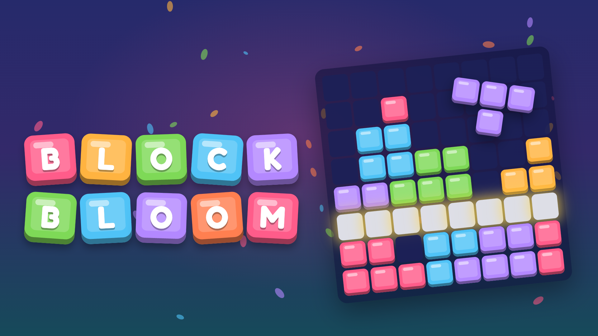

# Block Bloom

A calm, colorful block puzzle for web and mobile. Drag blocks onto an 8×8 board, fill rows or columns to clear them, and chain clears into combos. No timer. Plays in portrait and landscape.



## Features

- Drag-and-drop block puzzle with line clears, multi-line bonuses, combos and a Perfect (empty board) bonus
- Animated title screen, pause menu, sound and vibration settings
- Saves after every move: close the game and continue later
- Portrait and landscape layouts, switching live when the device rotates
- Optional rewarded "second chance" and between-game ads through each portal's own SDK

## Tech

- [Phaser 4](https://phaser.io) + TypeScript, built with [Vite](https://vite.dev)
- Sounds generated in code with Web Audio (no audio files)
- Game rules live in `src/logic.ts` with no Phaser dependency, so they are unit tested

```
src/
  logic.ts       board, pieces, scoring, save validation (pure, tested)
  logic.test.ts  rule tests (node --test)
  main.ts        game screen
  title.ts       title screen
  ui.ts          shared look: blocks, buttons, cards, layout
  sfx.ts         sound and vibration
  ads.ts         portal SDKs (CrazyGames, Poki); the only platform-specific code
public/icons/    SVG icons
store-assets/    covers, screenshots and preview videos for portal listings
```

## Run

Needs Node 24 or newer (tests run TypeScript directly).

```bash
npm install
npm run dev        # local dev server (ads are simulated)
npm test           # rule tests
```

## Build

```bash
npm run build              # plain web build in dist/
npm run build:crazygames   # CrazyGames build + block-bloom-crazygames.zip
npm run build:poki         # Poki build + block-bloom-poki.zip
```

The platform is picked at build time (`VITE_PLATFORM` in `.env.crazygames` / `.env.poki`); the game code is the same for every portal.

## License

Copyright © 2026 Bloom Games. All rights reserved. The code, art and sounds in this repository may not be copied, redistributed or published without permission.
