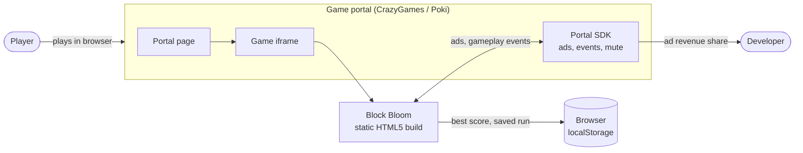
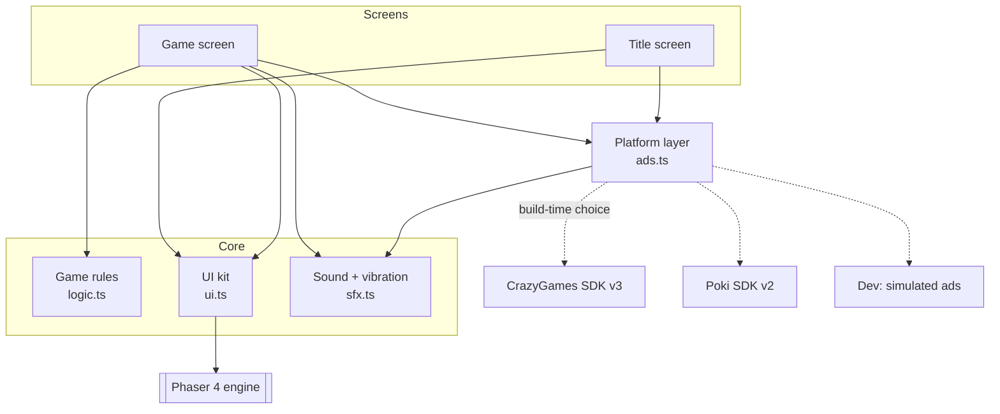
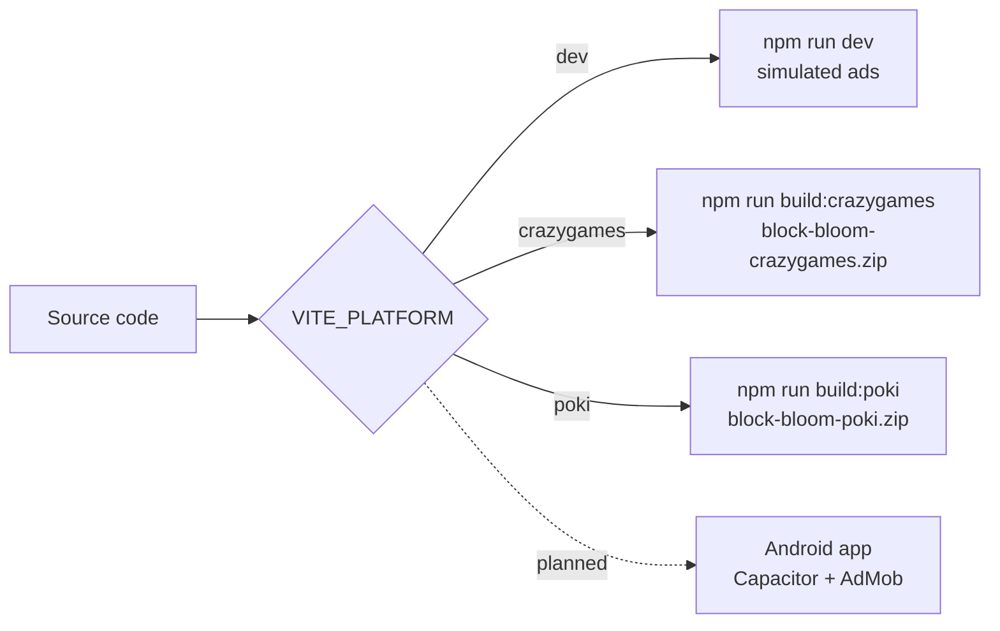

# Block Bloom: High-Level Design

How the game is put together and how it reaches players and earns money. For module-level detail see the [Low-Level Design](lld.md).

## 1. Goal

| Item | Decision |
|---|---|
| Product | Casual 8×8 block puzzle, short sessions, no timer |
| Players | Mobile and desktop web players on game portals |
| Revenue | Portal ads: rewarded video ("second chance") and between-game breaks |
| Platforms | CrazyGames (submitted), Poki (applied), Google Play / Android (planned) |
| Constraint | One codebase; only the ad layer differs per platform |

## 2. System context

The game is a static bundle (HTML, JS, SVG icons, ~440 KB zipped). It has no server and no accounts. Everything it remembers lives in the player's own browser.

## 3. Components

| Component | Responsibility | Depends on |
|---|---|---|
| Game rules (`logic.ts`) | Board, pieces, placement, line clears, scoring, dealing, save validation | Nothing (pure TypeScript, unit tested) |
| Game screen (`main.ts`) | Drag and drop, board drawing, effects, pause, game over, second chance, boot | Rules, UI kit, sound, platform layer |
| Title screen (`title.ts`) | Animated logo, best score, Play / Continue, settings | UI kit, rules (save check), platform layer |
| UI kit (`ui.ts`) | Colors, font, glossy blocks, buttons, cards, screen fades, orientation | Phaser |
| Sound (`sfx.ts`) | Synthesized sounds, vibration, mute state | Web Audio, Vibration API |
| Platform layer (`ads.ts`) | Talks to the portal SDK: ads, gameplay events, portal mute | Portal SDK script |

## 4. Platforms and builds

| Platform | SDK | Rewarded ad | Between-game ad | Status |
|---|---|---|---|---|
| Dev | none | simulated (always succeeds) | simulated | local only |
| CrazyGames | CrazyGames SDK v3 | `requestAd('rewarded')` | `requestAd('midgame')`, every 2nd game | in review |
| Poki | Poki SDK v2 | `rewardedBreak()` | `commercialBreak()`, every game (Poki throttles) | applied |
| Android | AdMob (planned) | rewarded | interstitial | planned |

## 5. Monetization rules

| Rule | Why |
|---|---|
| Rewarded video is optional, offered only at game over with a good score (≥ 200 and ≥ half of best) | Portal rule: rewards must feel special, not forced |
| One second chance per game | Keeps the reward valuable |
| No between-game ad right after a watched video | Never two ads in a row |
| When the portal reports ads are off (CrazyGames Basic launch), the second chance is free | No dead button; longer sessions help get promoted to Full launch |
| Sound is muted while any ad plays; gameplay is marked stopped | Portal requirements |

## 6. Data

| Key (localStorage) | Holds | Lifetime |
|---|---|---|
| `bb-best` | Best score | Forever |
| `bb-save` | Current run: board, tray, score, streak, revived | Written after every move, deleted at game over |
| `bb-muted`, `bb-vibrate` | Settings | Forever |
| `bb-hint-done` | First-game tutorial seen | Forever |

No personal data is collected and nothing leaves the device.

## 7. Key qualities

| Quality | How it is met |
|---|---|
| Fast load | Inline logo splash shows instantly; whole game ~440 KB; sounds are generated, not downloaded |
| Works everywhere | Portrait and landscape layouts, live switch on rotation, touch and mouse |
| Never loses a run | Saved after every move and on pause / tab switch; corrupt saves are rejected, not crashed on |
| Fair ads | All ad rules above live in one file (`ads.ts`) plus the game-over flow |
| Safe to change | Rules are pure and unit tested; platform code is isolated |
