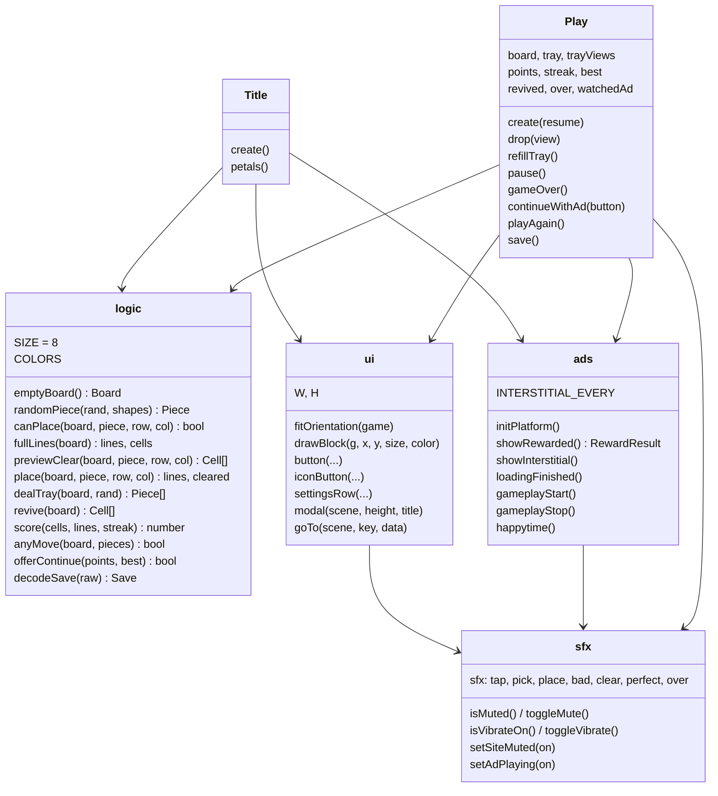
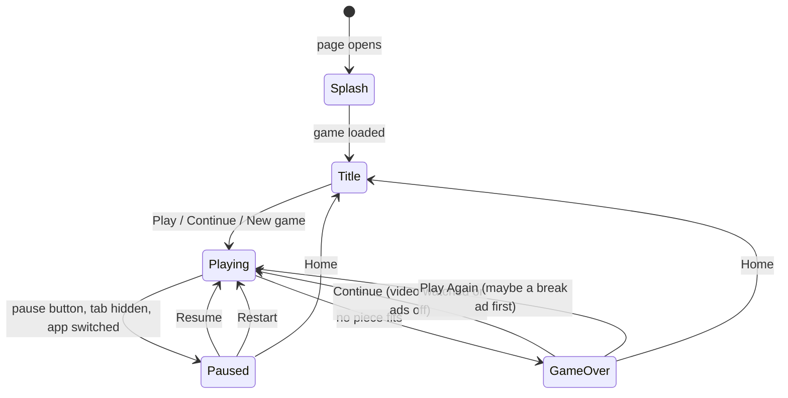
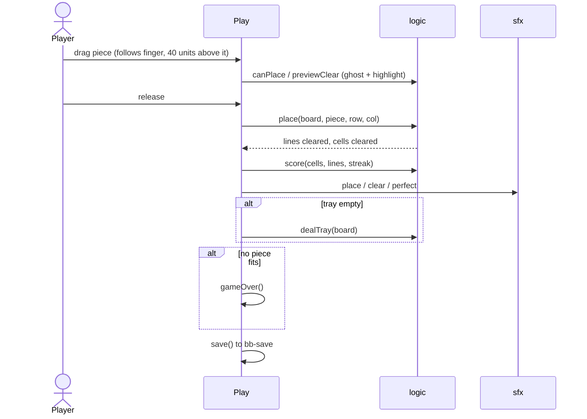
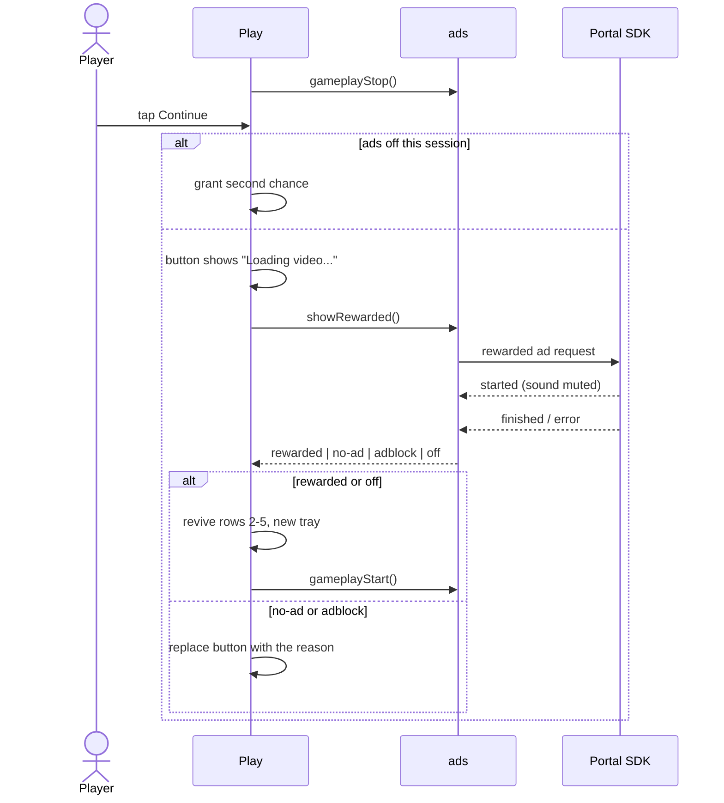

# Block Bloom: Low-Level Design

Module-level design: data types, functions, screen flow, sequences and layout. For the big picture see the [High-Level Design](hld.md).

## 1. Modules

## 2. Data types

| Type | Shape | Notes |
|---|---|---|
| `Cell` | `[row, col]` | 0-based |
| `Piece` | `{ cells: Cell[], color: number }` | Cells relative to the piece's top-left |
| `Board` | `(number \| null)[8][8]` | Color per cell, `null` = empty |
| `Save` | `{ board, tray: (Piece \| null)[3], points, streak, revived }` | Stored as JSON in `bb-save` |
| `RewardResult` | `'rewarded' \| 'no-ad' \| 'adblock' \| 'off'` | Only `'rewarded'` (or `'off'`, ads disabled) grants the second chance |

## 3. Rules

| Rule | Implementation |
|---|---|
| Pieces | 23 shapes, up to 5 long, plus 2×2 and 3×3 squares, L, T, S and corners |
| Dealing | `dealTray` picks 3 pieces, each from the shapes that fit the current board somewhere |
| Placing | `canPlace`: inside the board and on empty cells only |
| Clearing | Every full row and column clears at once (a cross clears both) |
| Score per move | `cells` if no clear, else `cells + lines² × 10 × max(1, streak)` |
| Streak (combo) | Moves in a row that cleared at least one line; resets on a move without a clear |
| Perfect | Board empty after a clear: +300 |
| Game over | `anyMove` is false for every piece left in the tray |
| Second chance offer | `points ≥ 200 && points ≥ best × 0.5`, once per game |
| Second chance effect | `revive` empties rows 2–5 and deals a new tray |
| Save validation | `decodeSave` rejects anything not exactly 8×8, 3 tray slots with valid cells, finite numbers |

## 4. Screen flow

## 5. Sequences

### Placing a piece

### Second chance at game over

## 6. Layout

Game units; Phaser scales the canvas to fit the screen. Orientation is picked from the window shape at every screen start and on rotation.

| Value | Portrait (720×1280) | Landscape (1280×720) |
|---|---|---|
| Cell size | 80 (block 74 + gap 6) | 80 |
| Board top-left | (40, 290) | (60, 40) |
| Tray | full width, centered at y = 1120 | right column x 724–1280, y = 500 |
| Score | top center, y = 185 | right column center, y = 240 |
| Pause button | top left | top right |
| Tray piece scale | ≤ 0.55, smaller for long pieces so they fit the tray box | same |
| Drag lift | piece bottom 40 above the finger, centered on it | same |

Rotating mid-game saves, restarts the game screen in the new layout and restores the run. A game-over card stays as it is until the next screen.

## 7. Platform layer

| Function | CrazyGames | Poki | Dev |
|---|---|---|---|
| `initPlatform()` | load SDK v3, `init()`, read and watch portal mute | load SDK v2, `init()` (failure ignored) | nothing |
| `showRewarded()` | `requestAd('rewarded')`, maps `adsDisabled` → off, `adblock` → adblock | `rewardedBreak()` → rewarded or no-ad | rewarded after 600 ms |
| `showInterstitial()` | `requestAd('midgame')` | `commercialBreak()` | 600 ms pause |
| `INTERSTITIAL_EVERY` | 2 games | 1 game | 2 games |
| `loadingFinished()` | nothing | `gameLoadingFinished()` | nothing |
| `gameplayStart/Stop()` | yes | yes | nothing |
| `happytime()` | on new best and Perfect | nothing | nothing |

If an SDK fails to load (ad blocker, offline), the game still runs without ads.

## 8. Sound

All sounds are generated with Web Audio oscillators; no audio files. The audio context is created on the first tap (browser autoplay rule).

| Sound | Trigger | Vibration (ms) |
|---|---|---|
| tap | any button | 10 |
| pick | start dragging | 8 |
| place | piece placed | 15 |
| bad | dropped where it doesn't fit | none |
| clear | lines cleared; pitch rises with streak | 25, or 30-40-30 for 2+ lines |
| perfect | board emptied, second chance | 40-50-40-50-80 |
| over | game over | 200 |

Muted when the player turns sound off, when the portal's own mute is on, or while an ad plays.

## 9. Tests

`npm test` runs `src/logic.test.ts` with Node's built-in test runner:

| Test | Checks |
|---|---|
| placement | in-bounds and empty-cell rules |
| cross clear | a row and a column clear together |
| scoring | line and streak multipliers |
| game over | `anyMove` false on a full board |
| preview | `previewClear` matches `place` without changing the board |
| dealing | every dealt piece fits the board |
| revive | rows 2–5 emptied, cleared cells returned |
| continue rule | score thresholds |
| save | round-trip, and junk input returns `null` |
